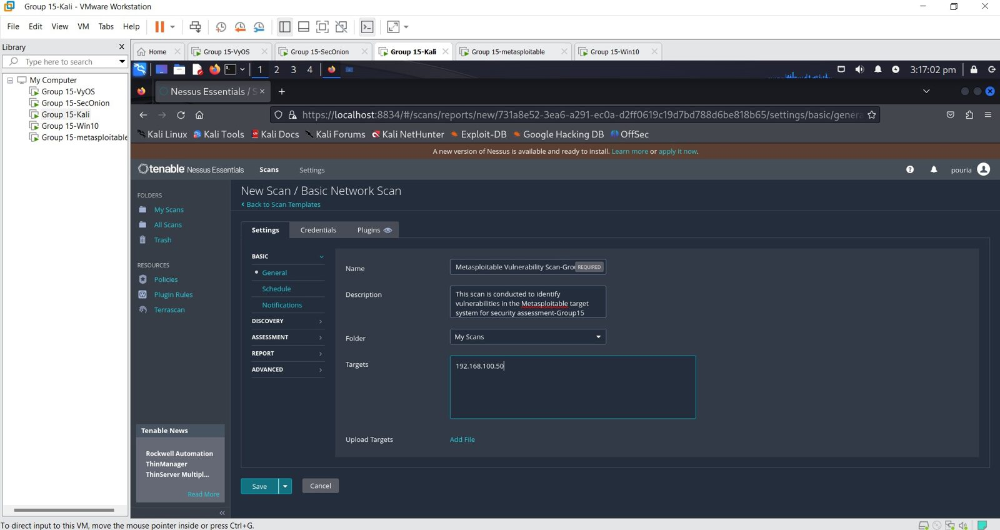
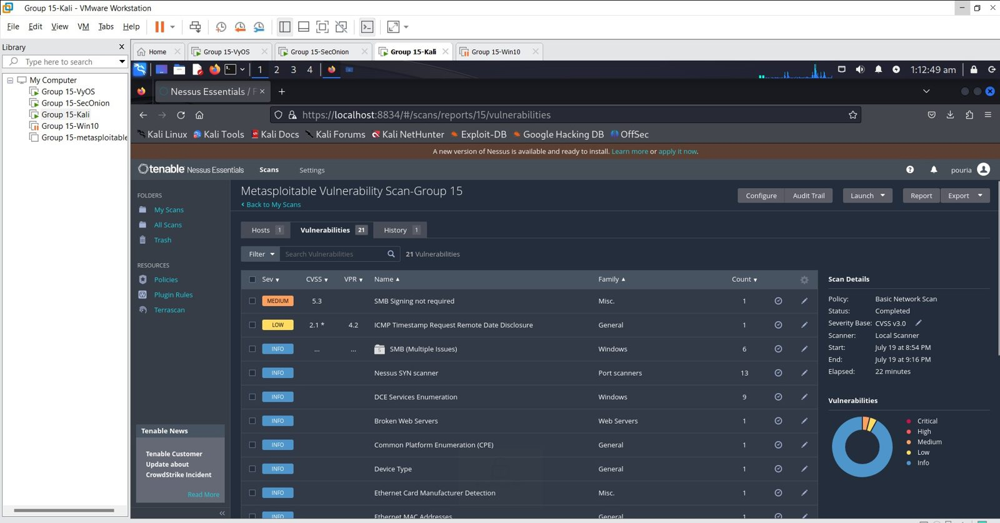
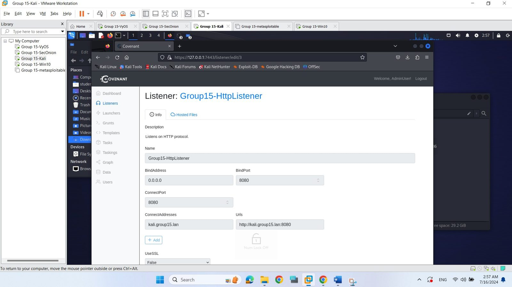
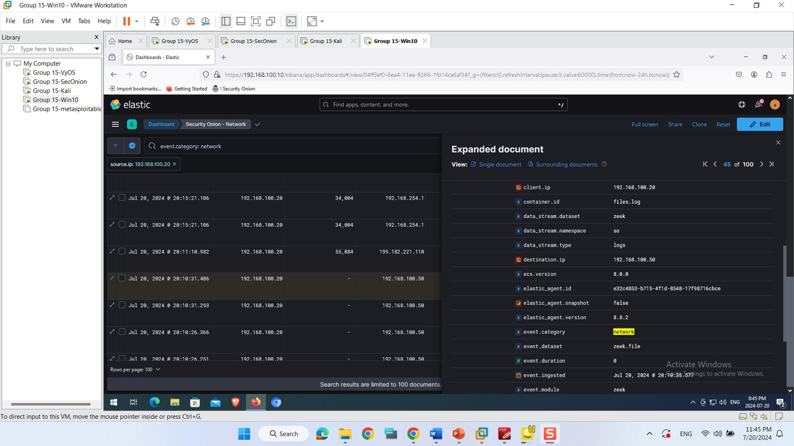
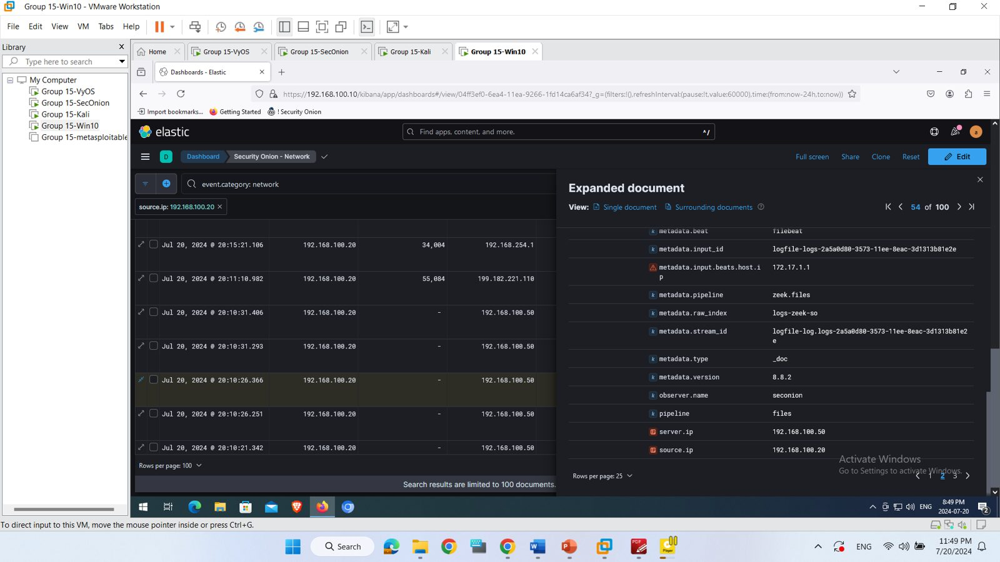

# Security Incident Simulation Lab (attacker and defender)

We built an isolated network, scanned it for vulnerabilities, compromised a Windows 10 machine with a command-and-control (C2) framework, and then investigated the attack as the defender and cleaned it up.

Term project for **SEC555 Cybersecurity** at Seneca Polytechnic, Summer 2024. **Team project** of two (Group 15).

> Everything here ran on virtual machines on a closed lab network, as the course assignment required. The payload, the persistence scripts and the phishing template are **not** published in this repo. Only the method and the evidence are.

## The lab

```
                    VyOS router (gateway)
                            |
          host-only network 192.168.100.0/24  (group15.lan)
     +--------------+--------------+---------------------+
     |              |              |                     |
  Kali Linux     Windows 10    Metasploitable 3     Security Onion
  .20            .50           (Win Server 2008 R2)  (Elastic, Zeek)
  attacker:      target         .100                 defender:
  Nessus,                       scan target          network monitoring
  Covenant C2
```

All five VMs ran in VMware Workstation. Each VM's name and hostname includes the group name, as the assignment required, so every screenshot can be traced to our environment.

## 1. Vulnerability scanning (Nessus Essentials)

| Target | Critical | High | Medium | Low | Info | Full report |
|---|---|---|---|---|---|---|
| Metasploitable 3 (Windows Server 2008 R2) | 20 | 31 | 39 | 7 | 156 | [PDF](reports/nessus-metasploitable3-win2008r2.pdf) |
| Windows 10 target | 0 | 0 | 1 | 1 | 44 | [PDF](reports/nessus-windows10-target.pdf) |

**What mattered most on Metasploitable 3:**
- **BlueKeep (CVE-2019-0708).** RDP remote code execution that needs no login.
- **An unsupported operating system.** Windows Server 2008 R2 no longer gets security patches.
- **Unsupported Apache 2.2, Tomcat 8.0 and PHP 5.3.**

The fix is the same for all of these: patch or replace what is out of support, and close RDP to untrusted networks until it is patched.

**What showed up on Windows 10:** SMB signing not required (medium), which allows man-in-the-middle attacks on SMB traffic. The fix is to require signing with the policy *Microsoft network server: Digitally sign communications (always)*. The low finding was ICMP timestamp disclosure, fixed by filtering ICMP timestamp requests.

| | |
|---|---|
|  Basic Network Scan configured in Nessus |  Results for the Windows 10 target |

## 2. The attack (Covenant C2)

The assignment was to pick a C2 framework other than Sliver, which the class had already used. We chose **Covenant**, a .NET C2 with a web interface.

1. **Set up the C2.** Ran Covenant in Docker on Kali, with an HTTP listener on port 8080 at `kali.group15.lan`.
2. **Built the payload.** Generated a PowerShell launcher and converted it to an EXE with PS2EXE.
3. **Delivered it.** Hosted the EXE on a Python HTTP server and sent the target user an email claiming a required software update, with a download link.
4. **Got execution.** The user ran the file, and the implant called back to the listener, giving remote code execution on the Windows 10 machine.
5. **Kept access.** A startup script re-launched the implant, and the connection came back after the target rebooted.

Antivirus bypass was out of scope for this project, as stated in the assignment.



## 3. The defence (Security Onion)

As defenders we worked from the network data in Security Onion.

- **Detection:** Security Onion flagged unusual network traffic. Zeek logs showed a file transfer between 192.168.100.20 (the attacker) and the Windows 10 machine at 192.168.100.50.
- **Tracing the infection:** the traffic led back to the downloaded payload, and from there to the phishing email that delivered it.
- **Indicators of compromise** to look for on other machines:
  - attacker IP `192.168.100.20`
  - host `kali.group15.lan`
  - C2 traffic to port `8080`
  - payload download from port `8888`
  - the fake-update executable
- **Cleanup:**
  1. Isolated the machine.
  2. Deleted the executable and the startup script that gave persistence.
  3. Restored from a clean backup.
  4. Checked that no trace of the attacker remained, including the persistence.

| | |
|---|---|
|  Zeek file-transfer events in Security Onion |  Event detail: attacker as source, target as destination |

## What I took from it

- **Scanning shows what could go wrong, not what did.** Nessus rated the Windows 10 machine as almost clean, but one email and one double-click compromised it anyway.
- **Patching only covers part of it.** Layered controls and continuous monitoring are what catch the attack that scanning and patching miss.
- **Cleanup isn't finished at deleting the malware file.** The startup script was the real foothold. If it had been missed, the attacker would have been back after the next reboot.

## Tools

Kali Linux · Nessus Essentials · Covenant C2 · Docker · PS2EXE · Python http.server · Security Onion (Elastic, Kibana, Zeek) · VyOS · Windows 10 · Metasploitable 3 · VMware Workstation
